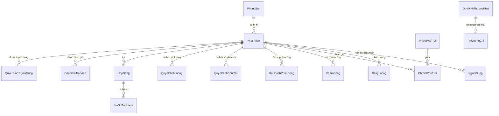

# Bài 7 - Hệ thống quản lý nhân sự

Ứng dụng quản lý nhân sự minh họa quy trình từ phân tích UML, thiết kế dữ liệu SQL Server đến giao diện quản lý. Phần mềm được viết bằng **Java Swing**, chạy như ứng dụng desktop trên Windows; **đây không phải website chạy trên trình duyệt**.

## Mục lục

- [1. Tổng quan](#1-tổng-quan)
- [2. Sơ đồ phân tích và thiết kế](#2-sơ-đồ-phân-tích-và-thiết-kế)
- [3. Cấu trúc dự án](#3-cấu-trúc-dự-án)
- [4. Chức năng theo vai trò](#4-chức-năng-theo-vai-trò)
- [5. Mô hình dữ liệu](#5-mô-hình-dữ-liệu)
- [6. Công nghệ và yêu cầu](#6-công-nghệ-và-yêu-cầu)
- [7. Chạy ứng dụng không cần SQL Server](#7-chạy-ứng-dụng-không-cần-sql-server)
- [8. Cài đặt và chạy với SQL Server](#8-cài-đặt-và-chạy-với-sql-server)
- [9. Tài khoản dữ liệu mẫu](#9-tài-khoản-dữ-liệu-mẫu)
- [10. Kiểm thử](#10-kiểm-thử)
- [11. Quy trình nghiệp vụ chính](#11-quy-trình-nghiệp-vụ-chính)
- [12. Lưu ý](#12-lưu-ý)

## 1. Tổng quan

Chương trình hỗ trợ quản lý hồ sơ nhân viên và các nghiệp vụ nhân sự liên quan:

- Phòng ban, nhân viên và trạng thái làm việc.
- Tuyển dụng, thử việc, đánh giá thử việc và hợp đồng.
- Quyết định lương, quyết định chức vụ và hồ sơ bảo hiểm.
- Phân công ca, chấm công và giờ phụ trội.
- Quyết định thưởng/kỷ luật, phê duyệt và phiếu thu/chi.
- Tính, lưu và tra cứu bảng lương.
- Đăng nhập, đổi mật khẩu và phân quyền menu theo vai trò.
- Tìm kiếm, sắp xếp, in bảng và xuất dữ liệu bảng ra CSV.

Giao diện có màn hình đăng nhập, trang tổng quan, thanh menu bên trái và các bảng/form nghiệp vụ. Các màn hình dùng tiếng Việt.

## 2. Sơ đồ phân tích và thiết kế

Các sơ đồ nằm trong thư mục [`anh/`](./anh/) và có thể mở/chỉnh sửa bằng draw.io:

| File | Nội dung |
| --- | --- |
| [`Cau_1_Class_ThuocTinh.drawio`](./anh/Cau_1_Class_ThuocTinh.drawio) | Xác định các lớp và thuộc tính |
| [`Cau_2_Class_LienKet.drawio`](./anh/Cau_2_Class_LienKet.drawio) | Liên kết giữa các lớp |
| [`Cau_3_UseCase_TongQuat.drawio`](./anh/Cau_3_UseCase_TongQuat.drawio) | Use case tổng quát |
| [`Cau_4_UseCase_PhanRa.drawio`](./anh/Cau_4_UseCase_PhanRa.drawio) | Phân rã use case thử việc |
| [`Cau_5_Activity_ThuViec.drawio`](./anh/Cau_5_Activity_ThuViec.drawio) | Luồng hoạt động thử việc |
| [`Cau_6_Sequence_KhenThuong.drawio`](./anh/Cau_6_Sequence_KhenThuong.drawio) | Tương tác tuần tự khi xử lý khen thưởng |

Các thực thể chính và quan hệ dữ liệu được khái quát như sau:



## 3. Cấu trúc dự án

```text
QuanLyNhanSu_SQLServer/
├── anh/                         # 6 sơ đồ Draw.io
├── lib/                         # JDBC driver và DLL xác thực (người dùng tự thêm)
├── out/                         # Các file .class sau khi biên dịch
├── sql/
│   ├── 01_tao_bang.sql          # Tạo database và các bảng
│   └── 02_kiem_tra.sql          # Truy vấn kiểm tra dữ liệu/kết nối
├── src/
│   ├── Main.java                # Điểm khởi chạy giao diện
│   ├── GiaoDien.java            # Giao diện Java Swing
│   ├── Model.java               # Thực thể và cấu trúc dữ liệu
│   ├── NghiepVu.java            # Quy tắc nghiệp vụ và lưu file
│   ├── SqlLuuTru.java           # Đọc/ghi SQL Server qua JDBC
│   ├── KiemThu.java             # Kiểm thử nghiệp vụ
│   ├── KiemThuGiaoDien.java     # Kiểm thử mở màn hình/menu
│   └── KiemTraSQL.java          # Kiểm tra kết nối SQL Server
├── ketnoi.properties            # Chế độ lưu trữ và cấu hình JDBC
├── chay_khong_SQL_windows.bat   # Biên dịch và chạy chế độ file
├── chay_SQLServer_windows.bat   # Biên dịch và chạy chế độ SQL Server
├── chay_kiem_tra_SQL_windows.bat # Kiểm tra kết nối SQL Server
└── kiem_thu_windows.bat         # Chạy kiểm thử nghiệp vụ
```

Luồng xử lý chính:

1. `Main` khởi tạo `NghiepVu` và mở `GiaoDien`.
2. `NghiepVu` nạp/lưu dữ liệu, kiểm tra điều kiện nghiệp vụ và thực hiện tính toán.
3. `Model` định nghĩa các thực thể và tập dữ liệu.
4. Dữ liệu được lưu bằng file cục bộ hoặc qua `SqlLuuTru` tùy chế độ cấu hình.

## 4. Chức năng theo vai trò

Tất cả vai trò đều có **Tổng quan**, đổi mật khẩu và đăng xuất.

| Vai trò | Các màn hình nghiệp vụ |
| --- | --- |
| Nhân sự (`NHAN_SU`) | Phòng ban, nhân viên, tuyển dụng, hợp đồng, quyết định lương/chức vụ, hồ sơ bảo hiểm, thưởng/kỷ luật |
| Trưởng phòng (`TRUONG_PHONG`) | Đánh giá thử việc, phân công ca làm |
| Ban chấm công (`CHAM_CONG`) | Bảng chấm công, phiếu phụ trội |
| Kế toán (`KE_TOAN`) | Bảng lương, phiếu thu/chi |
| Giám đốc (`GIAM_DOC`) | Duyệt hoặc từ chối quyết định thưởng/kỷ luật |
| Nhân viên (`NHAN_VIEN`) | Hồ sơ của tôi, lương của tôi |

Các bảng dữ liệu trong giao diện hỗ trợ lọc tìm kiếm, sắp xếp, in và xuất CSV. Chức năng thêm/sửa/xóa được cung cấp tùy nghiệp vụ; các thao tác quan trọng có kiểm tra điều kiện trước khi lưu.

## 5. Mô hình dữ liệu

Script [`sql/01_tao_bang.sql`](./sql/01_tao_bang.sql) tạo database `QuanLyNhanSuDB` và các bảng:

| Nhóm | Bảng |
| --- | --- |
| Tổ chức và tài khoản | `PhongBan`, `NhanVien`, `NguoiDung` |
| Tuyển dụng và hợp đồng | `QuyetDinhTuyenDung`, `DanhGiaThuViec`, `HopDong`, `HoSoBaoHiem` |
| Lương và chức vụ | `QuyetDinhLuong`, `QuyetDinhChucVu`, `BangLuong` |
| Lịch làm và chấm công | `KeHoachPhanCong`, `ChamCong`, `PhieuPhuTroi`, `ChiTietPhuTroi` |
| Thưởng, kỷ luật và tài chính | `QuyDinhThuongPhat`, `PhieuThuChi` |
| Quản lý mã tự tăng | `HeThong` |

Các bảng nghiệp vụ dùng khóa chính; những liên kết cần thiết được bảo vệ bằng khóa ngoại. `ChamCong` và `BangLuong` giới hạn mỗi nhân viên một bản ghi cho mỗi tháng/năm. `ChiTietPhuTroi` không cho lặp nhân viên trong cùng một phiếu; `PhieuThuChi` giới hạn mỗi quyết định có tối đa một phiếu.

Script tạo bảng có thể chạy lại mà không xóa bảng/dữ liệu hiện có. File [`sql/02_kiem_tra.sql`](./sql/02_kiem_tra.sql) có các truy vấn đếm bản ghi, xem nhân viên và liệt kê khóa ngoại.

## 6. Công nghệ và yêu cầu

- Windows.
- JDK 17 trở lên (`java` và `javac` cần dùng được trong Command Prompt/PowerShell).
- SQL Server chỉ bắt buộc nếu chọn chế độ lưu SQL Server.
- Microsoft JDBC Driver for SQL Server nếu dùng SQL Server; chế độ xác thực Windows cần thêm DLL xác thực phù hợp (x64 trên Windows 64-bit).
- Không cần cài thư viện bên ngoài khi chạy bằng file cục bộ.

## 7. Chạy ứng dụng không cần SQL Server

1. Cài JDK 17+ và kiểm tra `java -version`, `javac -version`.
2. Mở thư mục dự án `QuanLyNhanSu_SQLServer`.
3. Chạy `chay_khong_SQL_windows.bat`.

Batch file biên dịch các file trong `src` vào `out` rồi khởi chạy ứng dụng ở chế độ lưu file. Nếu cần chạy lệnh thủ công từ thư mục dự án:

```powershell
if (-not (Test-Path .\out)) { New-Item -ItemType Directory .\out | Out-Null }
javac -encoding UTF-8 -d out (Get-ChildItem .\src\*.java).FullName
java -Dfile.encoding=UTF-8 -Dqlyns.mode=file -cp out Main
```

Dữ liệu chế độ file được lưu mặc định tại `.quanlynhansu/nhansu.dat` bên trong thư mục home của người dùng. Có thể đổi đường dẫn bằng thuộc tính Java `-Dqlyns.data=<đường-dẫn-file>`; khi chỉ định thuộc tính này, chương trình tự chọn chế độ file.

## 8. Cài đặt và chạy với SQL Server

### 8.1. Tạo database

1. Khởi động SQL Server và mở SQL Server Management Studio (SSMS).
2. Mở [`sql/01_tao_bang.sql`](./sql/01_tao_bang.sql) và chạy toàn bộ script. Script tạo database `QuanLyNhanSuDB` nếu chưa tồn tại.
3. Mặc định cấu hình kết nối dùng `localhost:1433`, database `QuanLyNhanSuDB` và Windows Authentication. Nếu SQL Server của bạn dùng instance/port khác, cập nhật `jdbc.url` trong `ketnoi.properties`.

### 8.2. Thêm JDBC driver và cấu hình

1. Tải Microsoft JDBC Driver for SQL Server từ Microsoft.
2. Chép file driver tương thích JRE 11 trở lên, ví dụ `mssql-jdbc-13.6.0.jre11.jar`, vào `lib/`.
3. Với Windows Authentication, chép DLL `mssql-jdbc_auth-*.x64.dll` tương ứng với driver vào `lib/`. Nếu dùng SQL Authentication, cấu hình URL và điền `jdbc.user`, `jdbc.password` trong `ketnoi.properties` theo hướng dẫn trong file đó.
4. Đặt `che_do=sqlserver` trong `ketnoi.properties`.
5. Chạy `chay_kiem_tra_SQL_windows.bat` để kiểm tra driver, kết nối và database trước.
6. Nếu kiểm tra thành công, chạy `chay_SQLServer_windows.bat`.

Trong chế độ SQL Server, chương trình đọc các bảng khi khởi động. Nếu database chưa có phòng ban/tài khoản, chương trình khởi tạo dữ liệu mẫu.

## 9. Tài khoản dữ liệu mẫu

Khi dùng dữ liệu mẫu, mật khẩu ban đầu cho các tài khoản dưới đây là `123456`:

| Tài khoản | Vai trò |
| --- | --- |
| `nhansu` | Nhân sự |
| `truongphong` | Trưởng phòng |
| `chamcong` | Ban chấm công |
| `ketoan` | Kế toán |
| `giamdoc` | Giám đốc |
| `nhanvien` | Nhân viên |

Đây là tài khoản phục vụ trình diễn/kiểm thử, không dùng cho môi trường thật. Hãy đổi mật khẩu sau khi đăng nhập.

## 10. Kiểm thử

- `kiem_thu_windows.bat`: biên dịch và chạy bộ kiểm thử nghiệp vụ trên dữ liệu file tạm.
- `chay_kiem_tra_SQL_windows.bat`: kiểm tra cấu hình JDBC và truy vấn database SQL Server.
- `KiemThuGiaoDien`: smoke test giao diện, cần môi trường đồ họa; kiểm tra đăng nhập và các màn hình theo vai trò.

Kiểm thử nghiệp vụ bao gồm luồng thử việc/hợp đồng, bảo hiểm, phân công, chấm công, phụ trội, phê duyệt thưởng/phạt, tính lương, ràng buộc dữ liệu và đọc lại dữ liệu đã lưu.

## 11. Quy trình nghiệp vụ chính

1. Nhân sự tạo hồ sơ nhân viên ở trạng thái **Mới** và lập quyết định tuyển dụng/thử việc.
2. Trưởng phòng đánh giá sau khi thời gian thử việc kết thúc. Nếu không đạt, nhân viên kết thúc thử việc; nếu đạt, có thể tiếp tục ký hợp đồng.
3. Sau khi ký hợp đồng, nhân viên chuyển sang trạng thái chính thức. Hợp đồng dài hạn yêu cầu thông tin BHXH/BHYT và tạo hồ sơ bảo hiểm.
4. Nhân sự lập quyết định lương/chức vụ; trưởng phòng lập kế hoạch ca; ban chấm công nhập công và giờ làm.
5. Nhân sự lập quyết định thưởng/kỷ luật; giám đốc phê duyệt hoặc từ chối.
6. Kế toán lập bảng lương. Bản ghi lương gồm lương theo công, phụ cấp, tiền phụ trội, thưởng, phạt, bảo hiểm và thực lĩnh.

Lương công được tính theo lương tháng chia 26 ngày nhân ngày công. Tiền phụ trội được tính dựa trên số giờ và hệ số trong nghiệp vụ; các khoản thưởng/phạt chỉ tính theo quyết định đã được duyệt. Mỗi nhân viên chỉ có một bảng lương cho mỗi tháng/năm.

## 12. Lưu ý

- SQL Server phải cho phép kết nối theo đúng địa chỉ, cổng và phương thức xác thực trong `ketnoi.properties`.
- Chế độ SQL Server hiện ghi snapshot dữ liệu vào các bảng trong một transaction; đây là cách lưu trữ cho bài thực hành, không chạy đồng thời nhiều bản ứng dụng ghi vào cùng database.
- Mật khẩu trong dữ liệu mẫu được lưu theo cách đơn giản để phục vụ bài tập. Không dùng thiết kế này làm hệ thống xác thực cho môi trường thật.
- Nếu gặp lỗi thiếu `javac`, hãy cài JDK (không chỉ JRE) và thêm thư mục `bin` của JDK vào `PATH`.
